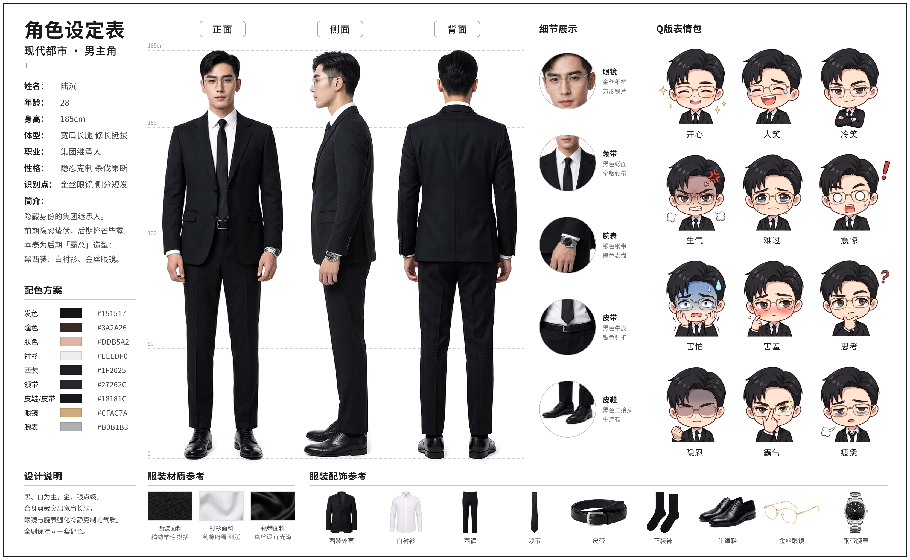
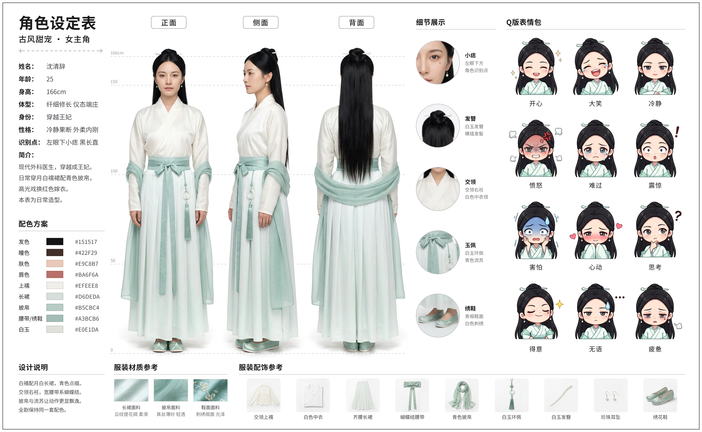
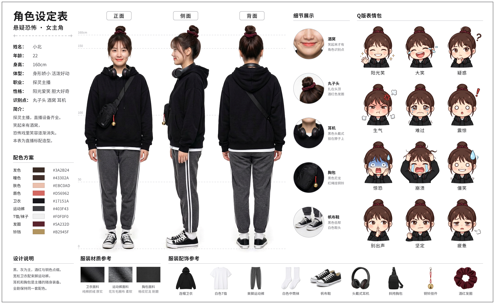

# 角色设定表

AI 仿真人短剧用的角色设定表：白底三视图、全套服装配饰、Q 版表情包。人物是虚构的，全部图片由 AI 生成。

| 角色 | 对应教程 | 成品 | 文件夹 |
| --- | --- | --- | --- |
| 陆沉 | 4.3 都市男主，后期「霸总」造型 | `lu-chen-character-sheet.png` | `lu-chen/` |
| 沈清辞 | 4.2 古风女主，日常造型（月白襦裙 + 青色披帛） | `shen-qingci-character-sheet.png` | `shen-qingci/` |
| 小北 | 4.4 悬疑主播，直播标配造型（黑色卫衣 + 运动裤 + 耳机） | `xiao-bei-character-sheet.png` | `xiao-bei/` |

## 文件

每个角色一个文件夹，结构相同：

| 路径 | 内容 |
| --- | --- |
| `<角色>-character-sheet.png` | 成品，3328 × 2048 |
| `<角色>/face.jpg` | 定妆照（半身正面）。之后生图、生视频时当角色参考图上传，用来锁定同一张脸 |
| `<角色>/parts/three-views.png` | 纯白底三视图，1024 × 1024，可以单独当参考图 |
| `<角色>/parts/` | 设定表用到的切图：三视图 3 张、表情 12 张、单品 9 张、细节 5 张、面料 3 张 |
| `<角色>/source/` | AI 生成的 5 张原图，未裁切 |
| `<角色>/sheet.html` | 版式和全部文字，改字、改色号都在这里 |
| `<角色>/cut_parts.py` | 把 `source/` 裁成 `parts/` 的脚本 |
| `<角色>/prompts.md` | 生成每张原图用的提示词 |

## 这张图是怎么做的

人物、表情、单品、面料是 AI 生成的图片。版式、文字、色号和身高标尺写在 `sheet.html` 里，用浏览器排好后截图，所以表里的字不会出现 AI 生图常见的错字，也可以随时改。

1. 先生成定妆照 `face.jpg`，后面每张图都拿它当参考图。
2. 按 `prompts.md` 生成 5 张原图：三视图、12 个 Q 版表情、4 格细节特写、9 件单品、3 块面料。
3. `python3 cut_parts.py` 把原图裁成 `parts/`：背景修成纯白，三视图做出透明底，表情和单品逐个切开。
4. `sheet.html` 把切图和文字排成 1664 × 1024 的版面，按 2 倍像素截图得到成品。

## 改完文字后重新导出

成品是用无头 Chromium 截的：视口 1664 × 1024，设备像素比 2，整页截图。

手动导出用 Chrome 自带的功能（这条路线没有实测过）：打开 `<角色>/sheet.html`，按 F12 打开开发者工具，切到设备模拟（Ctrl+Shift+M），尺寸填 1664 × 1024、DPR 选 2，再在设备工具栏的 ⋮ 菜单里选 Capture screenshot。DPR 选项要先在同一个菜单里点 Add device pixel ratio 才会出现。

字体优先用思源黑体（Noto Sans SC），电脑上没有时会换成苹方或微软雅黑，字形略有差别，版面不变。

## 给别的角色做一张

1. 复制一个现成的角色文件夹并改名，按服装颜色选：
   - 全身深色用 `lu-chen/`。
   - 白色或浅色服装用 `shen-qingci/`，它的 `cut_parts.py` 不靠衣服和白背景的色差来分辨人物。
   - 深色衣服里夹着白色的东西（T 恤下摆、白袜、白鞋底）用 `xiao-bei/`。
2. 按 `prompts.md` 换掉角色描述，重新生成定妆照和 5 张原图，放进 `source/`。
3. `cut_parts.py` 开头的 `CONFIG` 是按当前图片量的像素坐标，换图后要重新量。
4. 改 `sheet.html`：文字和色号；三张 `.view` 图片的位置和大小、身高标尺的刻度也要跟着人物改（`shen-qingci/` 和 `xiao-bei/` 的 `cut_parts.py` 运行时会打印每张视图的显示尺寸、人物在图内的左右边界、头顶线和鞋底线的位置）。改完重新导出。

## 已知的不足

三张表都有的：

- 三视图原图只有 1024 × 1024，放进成品时放大了 1.5 到 1.6 倍，放到 100% 看，人物比文字略软。需要清晰的脸请用 `face.jpg`。
- 单品图和细节图是分开生成的，和三视图里穿在身上的那件在小处会有出入。
- 「配色方案」的色号是在图片上取样后取整的，同一件衣服在不同光线下会有偏差，和教程第 4 章按插画风格写的色号不完全相同。
- 表上的身高、体型、性格措辞、面料名称是补写的，教程里没有。
- 每张表 12 个表情，教程点名的是其中 4 个，其余 8 个是补的。
- 只在无头 Chromium 里导出过，没有在别的浏览器和别的字体下核对版面。

沈清辞这张：

- 教程写的是「月白交领襦裙」，出图是白色上襦配月白色长裙，表上按出图标注。
- 发簪在三视图里是直的，单品图里略弯；玉佩的绳结在单品图里更复杂；披帛在单品图里叠成了围巾的样子。
- 12 个 Q 版表情里有 4 个（大笑、难过、得意、疲惫）生成时漏画了左眼下的小痣，是 `cut_parts.py` 补画的圆点。
- 身高标尺的 166cm 画在头顶，不算发髻。
- 单品图保留了生成时的浅灰底色，白色单品在纯白底上看不清。另外两张的单品是白底的，这一栏的样子不一样。

小北这张：

- 教程只写了「黑色卫衣 + 运动裤 + 耳机」。白 T 恤、运动裤的深灰色和白条纹、白袜、帆布鞋、胸包、铜铃挂件、酒红色发圈、刘海都是补的，用来把身上穿的东西列全，再给角色一个小道具（铜铃）。
- 教程提示词里的「暗黑悬疑风，冷色调」没有用在这张表上，表里是白底、中性光。
- 酒窝在定妆照里比较浅，是嘴角两侧的两个小凹点；脸颊上有几颗没有要求的小痣。
- 单品图里的胸包是竖长的单肩包款式，和三视图里身上那只不一样。
- Q 版表情的发色比照片里浅。
- 身高标尺的 160cm 画在头顶，不算丸子头。
- 鞋头和鞋底是白色的，抠不出准确的轮廓，所以鞋子四周留着一圈原图的浅灰色地面阴影。
