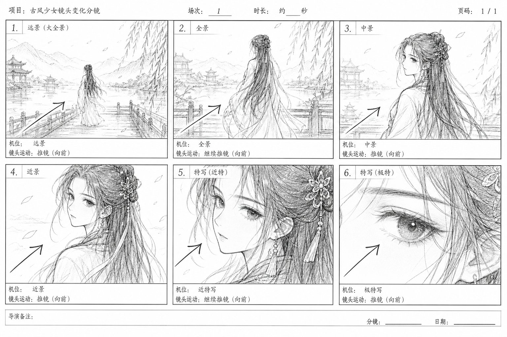
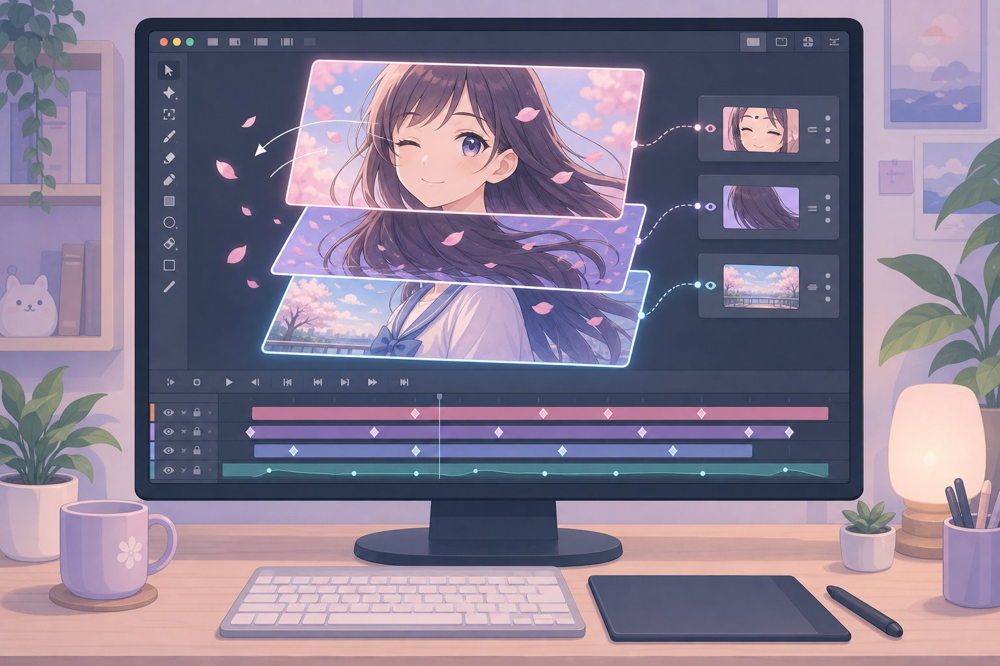
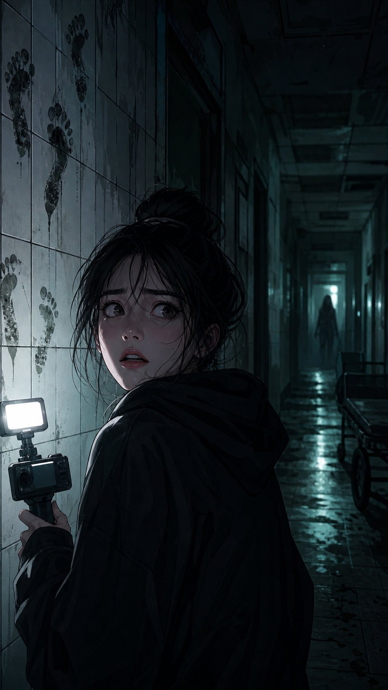

# 漫剧制作零基础大白话教程

> 一句话定位：**漫剧 = 漫画的画面 + 动画的动态 + 短剧的节奏 + 配音的情绪**。
> 本教程按「概念 → 流程 → 每个环节的多个实战案例 → 完整成片拆解 → 避坑清单」的顺序写，零基础照着做就能出第一条漫剧。
> **工具以豆包为准：** 文字类工作（选题、剧本、分镜、提示词、配音稿）全部用豆包完成，生图用豆包生图，剪辑动态用剪映。每个环节都配「图 + 文 + 可复制的豆包提示词」。


---

## 目录

- [第 0 章：先搞懂漫剧到底是什么](#第-0-章先搞懂漫剧到底是什么)
- [第 1 章：工具箱（手机 + 电脑免费方案）](#第-1-章工具箱手机--电脑免费方案)
- [第 2 章：选题与剧本](#第-2-章选题与剧本)
- [第 3 章：分镜脚本](#第-3-章分镜脚本)
- [第 4 章：角色与场景设计](#第-4-章角色与场景设计)
- [第 5 章：配音与音效](#第-5-章配音与音效)
- [第 6 章：动态制作（让画面动起来）](#第-6-章动态制作让画面动起来)
- [第 7 章：剪辑与包装](#第-7-章剪辑与包装)
- [第 8 章：发布与运营](#第-8-章发布与运营)
- [第 9 章：3 个完整实战案例（从 0 到成片）](#第-9-章-3-个完整实战案例从-0-到成片)
- [第 10 章：新手避坑清单 + 30 天学习计划](#第-10-章新手避坑清单--30-天学习计划)

---

## 第 0 章：先搞懂漫剧到底是什么

### 0.1 一句话解释

想象一下：你刷到一条竖屏视频，画面是精美的漫画风，人物会眨眼、转头、走路，背景有飘落的花瓣或雨丝，耳边传来配音演员的台词和 BGM，剧情像短剧一样一集接一集——**这就是漫剧**。

它不是纯漫画（漫画是静态翻页），也不是真人短剧（短剧是真人拍摄），更不是传统动画（动画制作成本高、周期长）。漫剧的核心优势是：**成本低、速度快、风格统一、适合竖屏连载**。

### 0.2 漫剧 vs 其他形式，一张表看懂

| 形式 | 画面 | 动态 | 配音 | 制作成本 | 适合人群 |
|---|---|---|---|---|---|
| 漫画 / 条漫 | 静态图 | 无，靠翻页 | 无 | 低 | 喜欢画画的人 |
| 有声剧 / 广播剧 | 无画面 | 无 | 有 | 低 | 听故事的人 |
| 真人短剧 | 真人实拍 | 全动态 | 现场收音 | 高 | 有演员/设备的人 |
| 传统动画 | 手绘/3D | 全动态 | 专业配音 | 很高 | 团队 |
| **漫剧** | **漫画风插画** | **局部动态（眨眼、推镜、粒子）** | **AI/真人配音** | **中低** | **个人/小团队，新手友好** |

**大白话记忆法：** 漫剧就是「用漫画当底图，用动画的手法让它动起来，再配上短剧的台词和节奏」。

### 0.3 漫剧的 4 种常见类型

1. **动态漫（图层动画型）**：最主流。把漫画拆成人物层、背景层、特效层，做眨眼、口型、推拉镜头。代表：大多数古风甜宠、霸总漫剧。
2. **条漫改编型**：把现成的条漫/漫画直接做动态化，适合有 IP 的团队。
3. **AI 漫剧**：用 AI 生成画面 + AI 配音 + AI 动效，速度最快，适合测试题材。
4. **竖屏漫剧（短剧化）**：专为抖音/快手/小程序优化，9:16 竖屏，单集 1-3 分钟，强钩子、强反转。

> 新手建议：从「动态漫 + 竖屏」起步，成本最低、变现最快。

### 0.4 漫剧制作全流程（先看地图，再上路）

```
选题 → 剧本 → 分镜 → 角色/场景设计 → 配音 → 动态制作 → 剪辑包装 → 发布运营
```

每一步的产出物（交付物）要清楚：

| 环节 | 产出物 | 一句话说明 |
|---|---|---|
| 选题 | 一句话梗概 + 目标人群 | 决定你做什么，不做错方向 |
| 剧本 | 分集大纲 + 台词稿 | 决定观众看不看得下去 |
| 分镜 | 分镜表 + 草图 | 把文字变成镜头 |
| 角色/场景 | 设定表 + 场景图 | 决定画面好不好看、像不像 |
| 配音 | 干声 + 混音 | 决定情绪对不对 |
| 动态 | 动效工程文件 | 让画面活起来 |
| 剪辑 | 成片 MP4 | 决定节奏和完播率 |
| 发布 | 标题/封面/简介 | 决定有没有人点进来 |

**新手最大的误区：** 一上来就画图做动画。正确顺序是先把剧本和分镜做扎实——**剧本不行，画面再美也没人看完**。

---

## 第 1 章：工具箱（以豆包为核心，手机 + 电脑免费方案）

原则：**先用免费工具跑通全流程，再考虑付费升级**。全流程只需要 2 个核心工具：**豆包（AI 大脑）+ 剪映（制作车间）**。


> **为什么以豆包为准？** ① 免费、中文理解强，写剧本台词最像「人话」；② 能写（剧本/分镜/提示词）也能画（生图），一个工具干三件事；③ 和剪映同属字节生态，产物无缝衔接。其他 AI 工具可以当备选，但默认先用豆包——**出问题先怀疑提示词，不要急着换工具**。

### 1.1 工具清单（豆包优先）

| 环节 | 首选（以豆包为准） | 备选 | 说明 |
|---|---|---|---|
| 选题/剧本/台词 | **豆包** | ChatGPT、Kimi | 豆包直接出大纲+台词稿（见附录 D 提示词） |
| 分镜表 | **豆包** | 手画草图 | 豆包按 6 要素直接输出分镜表 |
| 画图/生图 | **豆包生图** | 即梦AI、Stable Diffusion | 把附录 B 提示词发给豆包即可出图 |
| 配音稿 | **豆包**（写情绪标注稿） | — | 稿子给剪映 AI 配音用 |
| 配音 | 剪映AI配音 | 豆包语音试听、真人配音 | 音色全剧统一 |
| 动态 | 剪映（关键帧动画） | AE、Live2D Cubism | 新手用剪映足够 |
| 剪辑 | 剪映手机版/电脑版 | DaVinci Resolve | 配音+动态+剪辑三合一 |
| 封面/字幕 | 剪映、醒图 | Canva 可画 | 封面大字对比要强 |

### 1.2 新手推荐的「一套组合」

- **纯手机路线（零成本起步）：** 豆包 App（选题→剧本→分镜→提示词→生图）+ 剪映手机版（配音+动态+剪辑）
- **电脑路线（效率更高）：** 豆包网页版 + 剪映电脑版（改图用 Krita）
- **进阶路线：** 豆包打底 + AE 做动态 + PR/达芬奇剪辑 + Live2D 骨骼动画

> 记忆法：**豆包是编剧部，剪映是制片厂**。所有「想」的事问豆包，所有「做」的事在剪映。

### 1.3 案例：豆包 + 剪映，10 分钟做出第一条漫剧

1. 打开**豆包** → 发送附录 D 的「单集剧本提示词」+ 你的选题 → 复制生成的台词稿
2. 豆包生图（或即梦）→ 生成 1 张漫画风竖屏图 → 保存到相册
3. 打开**剪映** → 新建项目 → 导入这张图
4. 点击「文本 → 智能配音」→ 粘贴台词 → 选一个音色 → 生成配音
5. 选中图片 → 点击「动画」→ 选「推镜」→ 设置 3 秒；点「音频 → 音乐」→ 选 BGM，音量调到 15%
6. 点击「文本 → 新建文本」→ 输入字幕（黄色描边）→ 导出 1080×1920 → 发布

> 这 6 步就是漫剧的最小闭环。先做出一条丑的，再做一条美的。

---

## 第 2 章：选题与剧本

### 2.1 选题：先想清楚「给谁看、为什么看」


漫剧选题就 3 个问题：

1. **题材对不对？** 新手优先选：古风甜宠、都市逆袭、霸总虐恋、悬疑恐怖、校园青春。这 5 类在短视频平台流量最大、制作门槛最低。
2. **钩子够不够？** 一句话就能让人想点进来。公式：**身份反差 + 悬念 + 情绪**。
3. **你能不能持续产出？** 选一个你能画/能生成的画风，能连载 20 集以上。

**选题公式（套用即可）：**
- 古风甜宠：`[冷酷王爷/师尊] × [穿越/失忆小医女]` + 一见钟情
- 都市逆袭：`[被抛弃的赘婿/穷小子]` + `[隐藏身份]` + 打脸逆袭
- 悬疑恐怖：`[深夜直播]` + `[禁忌规则]` + 层层反转

### 2.2 剧本结构：漫剧单集 1-3 分钟怎么装

漫剧单集时长 60-180 秒，台词约 150-400 字。结构固定为 **「3 秒钩子 + 30 秒铺垫 + 60 秒冲突 + 30 秒反转/悬念」**。

- **0-3 秒（钩子）：** 必须有冲突或悬念，不能有片头。例：「你不是说你只是个送外卖的吗？！」
- **3-30 秒（铺垫）：** 交代人物关系和处境，快速带入。
- **30-90 秒（冲突）：** 冲突升级，情绪拉满，观众开始上头。
- **90-120 秒（反转/悬念）：** 抛出新信息或反转，逼观众点下一集。

### 2.3 案例 A：古风甜宠《医妃倾城》第 1 集剧本

**一句话梗概：** 现代外科医生穿越成被冷落的王妃，第一天就救了刺杀王爷的刺客，冷酷王爷对她起了兴趣。

| 时间 | 画面/动作 | 台词 | 音效/BGM |
|---|---|---|---|
| 0-3s | 王妃睁眼特写，惊恐 | 王妃（内心）：「我……穿越了？！」 | 心跳声 + 弦乐骤停 |
| 3-15s | 回忆闪回：原主被冷落、王爷冷漠 | 旁白：三月前，她嫁入王府，王爷从未正眼看过她。 | 低沉钢琴 |
| 15-40s | 刺客闯入，王爷受伤倒地 | 刺客：受死吧！王爷：来人—— | 刀剑声、重物倒地 |
| 40-70s | 王妃冲上前按压伤口 | 王妃：别动！再乱动你会失血过多！ | 紧张鼓点 |
| 70-100s | 王爷睁眼，第一次认真看她 | 王爷：你……会医术？王妃：闭嘴，专心。 | BGM 转暖 |
| 100-120s | 王妃抬头，镜头推近，悬念 | 王妃（内心）：这王爷……好像认识我？ | 悬念音效，黑屏 |

**为什么这个剧本好：** 3 秒有穿越钩子，30 秒交代关系，冲突（刺杀）来得快，结尾「好像认识我」留悬念，观众必点第 2 集。

### 2.4 案例 B：都市逆袭《赘婿归来》第 1 集剧本

**一句话梗概：** 被全家看不起的赘婿，在岳父寿宴上被当众羞辱，却接到一通电话——「少爷，集团等您回去主持大局」。

| 时间 | 画面/动作 | 台词 | 音效/BGM |
|---|---|---|---|
| 0-3s | 岳母把红包摔在男主脸上 | 岳母：你也配吃这顿饭？滚出去！ | 摔纸声 |
| 3-20s | 男主低头，众人嘲笑 | 旁白：三年赘婿，他忍了三年。 | 低沉压抑 BGM |
| 20-50s | 岳父当众宣布断绝关系 | 岳父：从今天起，你不许再踏入这个家！ | 众人哄笑 |
| 50-80s | 手机震动，男主接电话 | 电话音：少爷，董事长病危，集团等您回去。 | 电话铃声 |
| 80-110s | 男主抬头，眼神变冷 | 男主：好，我这就回去。 | BGM 骤停 |
| 110-120s | 男主转身，镜头跟拍，悬念 | 岳母（愣住）：他……他刚才说什么？ | 悬念音效 |

**为什么这个剧本好：** 开头 3 秒就是羞辱冲突，观众代入感强；「少爷」两个字是身份反差钩子；结尾岳母的反应让观众想看打脸。

### 2.5 案例 C：悬疑恐怖《深夜直播》第 1 集剧本

**一句话梗概：** 主播在废弃医院直播探灵，弹幕刷出一条诡异留言：「主播，别回头，你身后站着一个人」。

| 时间 | 画面/动作 | 台词 | 音效/BGM |
|---|---|---|---|
| 0-3s | 主播对镜头笑，弹幕飘过 | 弹幕：主播，别回头！ | 诡异电子音 |
| 3-20s | 主播转身，空无一人 | 主播：哈哈，弹幕又在吓我。 | 环境风声 |
| 20-50s | 弹幕刷屏：「真的有人」「他动了」 | 主播：别闹了，我身后什么都没有。 | 心跳声渐强 |
| 50-80s | 镜头扫过墙面，墙上有湿脚印 | 主播（颤抖）：这……这脚印哪来的？ | 脚步声 |
| 80-110s | 主播回头，镜头剧烈晃动 | 主播：谁？！出来！ | 尖锐音效 |
| 110-120s | 画面切黑，只剩直播间人数暴涨 | 系统音：直播间人数 10 万+ | 断电声，黑屏 |

**为什么这个剧本好：** 悬疑题材靠「信息差」推进——观众和主播同时看到弹幕警告，代入感拉满；结尾人数暴涨是反转钩子。

### 2.6 剧本写作 5 个铁律

1. **台词要短：** 每句不超过 15 字。长台词拆成两句，中间加反应镜头。
2. **少旁白，多对话：** 旁白每集不超过 3 句，剧情靠人物对话推进。
3. **每集一个情绪点：** 甜/虐/爽/吓，整集只打一个情绪，不要贪多。
4. **结尾必须留钩子：** 悬念、反转、危机三选一，逼观众点下一集。
5. **先写大纲再写台词：** 大纲 200 字，台词 300 字，大纲不通就别写台词。

### 2.7 用豆包 3 分钟写出一集剧本（可直接复制）

把下面的提示词连同你的选题一起发给豆包，它会直接输出「大纲 + 台词稿 + 分镜表」三件套：

```text
你是一名竖屏漫剧编剧。请为我写第 1 集剧本，要求：
1. 题材：【填：古风甜宠/都市逆袭/悬疑恐怖】；一句话梗概：【填你的想法】；
2. 时长 120 秒，按「3秒钩子+30秒铺垫+60秒冲突+30秒反转/悬念」结构；
3. 先给 200 字大纲，再给台词表（时间|画面/动作|台词|音效/BGM 四列）；
4. 每句台词不超过 15 字，旁白不超过 3 句，台词前标注情绪；
5. 结尾必须留钩子（悬念/反转/危机三选一）。
```

> **改编小说？** 先用本仓库 `novel-templates/` 里的《豆包小说拆解模板》把小说拆成「主线+人物+爽点」，再把拆解结果粘贴给豆包套用上面的剧本提示词——剧情骨架直接就有了。

---

## 第 3 章：分镜脚本

### 3.1 什么是分镜？大白话解释

分镜就是**把剧本翻译成镜头**。剧本说「王妃救王爷」，分镜要拆成：王妃特写 → 王爷倒地全景 → 王妃冲过去中景 → 按压伤口特写 → 王爷睁眼近景 → 对视特写。

新手没有分镜，制作时就会对着剧本一张张画，画到一半发现镜头乱了、节奏乱了，返工到崩溃。

### 3.2 分镜表的 6 个要素

| 要素 | 说明 | 例子 |
|---|---|---|
| 镜号 | 镜头编号 | 01、02、03 |
| 景别 | 远景/全景/中景/近景/特写 | 特写（只拍脸） |
| 画面内容 | 这一镜拍什么 | 王妃睁眼，惊恐表情 |
| 镜头运动 | 静止/推/拉/摇/跟 | 缓慢推近 |
| 台词/音效 | 这一镜说什么、听什么 | 台词+心跳声 |
| 时长 | 这一镜几秒 | 3 秒 |

### 3.3 景别速查（新手必背）

- **远景：** 交代环境（王府全貌、城市夜景）
- **全景：** 交代人物位置关系（两人站在院子里）
- **中景：** 拍到腰部以上（对话、动作）
- **近景：** 拍到肩部以上（情绪、表情）
- **特写：** 只拍脸/手/眼睛（震惊、流泪、握拳）

**铁律：** 对话用中景/近景，情绪用特写，交代环境用远景。**连续 3 个镜头不能用同一个景别**，否则画面会闷。

### 3.4 案例 A：《医妃倾城》第 1 集分镜表（节选 8 镜）



| 镜号 | 景别 | 画面内容 | 镜头运动 | 台词/音效 | 时长 |
|---|---|---|---|---|---|
| 01 | 特写 | 王妃睁眼，瞳孔收缩 | 静止 | 内心：我穿越了？！+心跳 | 3s |
| 02 | 远景 | 王府夜景，灯火 | 缓慢推近 | 旁白：三月前她嫁入王府 | 5s |
| 03 | 中景 | 王爷背对王妃，冷漠转身 | 静止 | 王爷：退下。 | 4s |
| 04 | 全景 | 刺客破窗而入，王爷倒地 | 快速摇镜 | 刺客：受死！+刀剑声 | 5s |
| 05 | 中景 | 王妃冲上前，跪地按压伤口 | 跟拍 | 王妃：别动！ | 5s |
| 06 | 特写 | 王妃的手按在伤口上，血流 | 静止 | 紧张鼓点 | 3s |
| 07 | 近景 | 王爷睁眼，第一次认真看她 | 缓慢推近 | 王爷：你会医术？ | 4s |
| 08 | 特写 | 王妃抬头，眼神一顿 | 静止 | 内心：他好像认识我+悬念音 | 3s |

### 3.5 案例 B：《赘婿归来》分镜拆解（羞辱戏怎么拍）

羞辱戏是逆袭题材的核心，分镜要点：**先拍羞辱者，再拍被羞辱者，最后拍反转**。

| 镜号 | 景别 | 画面内容 | 镜头运动 | 台词/音效 | 时长 |
|---|---|---|---|---|---|
| 01 | 近景 | 岳母冷笑，摔红包 | 静止 | 岳母：滚出去！ | 3s |
| 02 | 特写 | 红包落在男主脚边 | 静止 | 摔纸声 | 2s |
| 03 | 中景 | 男主低头，众人围笑 | 缓慢拉远 | 旁白：他忍了三年 | 5s |
| 04 | 近景 | 岳父宣布断绝关系 | 静止 | 岳父：不许再踏入！ | 4s |
| 05 | 特写 | 男主手机震动 | 静止 | 电话铃声 | 2s |
| 06 | 近景 | 男主接电话，眼神变冷 | 缓慢推近 | 电话音：少爷，集团等您 | 4s |
| 07 | 中景 | 男主转身离开，众人愣住 | 跟拍 | 岳母：他说什么？ | 4s |

### 3.6 案例 C：《深夜直播》分镜拆解（恐怖戏怎么拍）

恐怖戏分镜要点：**先给观众看「异常」，再给主播看「异常」，最后给观众看「更异常」**，层层加码。

| 镜号 | 景别 | 画面内容 | 镜头运动 | 台词/音效 | 时长 |
|---|---|---|---|---|---|
| 01 | 中景 | 主播对镜头笑，弹幕飘过 | 静止 | 弹幕：别回头！ | 3s |
| 02 | 全景 | 主播转身，身后空无一人 | 静止 | 主播：哈哈吓我？ | 4s |
| 03 | 特写 | 弹幕刷屏「他动了」 | 静止 | 电子音 | 3s |
| 04 | 近景 | 主播笑容僵住 | 缓慢推近 | 主播：别闹了 | 3s |
| 05 | 特写 | 墙面湿脚印 | 摇镜扫过 | 脚步声 | 4s |
| 06 | 近景 | 主播颤抖回头 | 手持晃动 | 主播：谁？！ | 3s |
| 07 | 黑屏 | 只剩系统音 | — | 人数10万+ | 3s |

### 3.7 新手做分镜的 3 个方法

1. **豆包文字分镜（最快，推荐）：** 把剧本发给豆包，直接要 6 要素表格（提示词见下），不画草图，适合赶工。
2. **草图分镜：** 用铅笔在纸上画火柴人草图，标注镜头运动箭头，适合重要戏。
3. **AI 分镜草图：** 把豆包输出的分镜表逐镜发给豆包生图，生成每镜画面草图，适合不会画画的人。

**豆包生成分镜表提示词（可直接复制）：**

```text
你是漫剧分镜师。请把我下面的剧本拆成分镜表，要求：
1. 严格输出 6 列表格：镜号|景别|画面内容|镜头运动|台词/音效|时长；
2. 每镜 2-6 秒，一集 6-10 镜，连续 3 镜不重复景别；
3. 对话用中景/近景，情绪用特写，环境用远景；
4. 第 1 镜必须是钩子（冲突/悬念），最后 1 镜必须留钩子。
剧本：【粘贴上一步豆包生成的台词稿】
```

---

## 第 4 章：角色与场景设计

### 4.1 角色设计：先做「设定表」，再画正片

设定表包含：**三视图（正/侧/背）+ 表情包（喜/怒/哀/乐）+ 服装配色 + 身高比例**。


**新手画风选择建议：**
- 古风甜宠：国风厚涂 / 扁平插画，配色以粉、青、白为主
- 都市逆袭：现代写实风 / 韩漫风，配色以黑、白、蓝为主
- 悬疑恐怖：暗黑风 / 水彩风，配色以黑、灰、血红为主

**关键原则：** 一个角色只用 3 个主色（肤色+发色+服装色），全剧统一。换衣服可以，换画风不行。

### 4.2 案例 A：古风女主「沈清辞」设定

- **身份：** 现代外科医生穿越成的王妃，25 岁
- **外貌：** 黑长直发、杏眼、左眼下小痣（识别点）
- **服装：** 月白交领襦裙 + 青色披帛（日常）、红色嫁衣（高光戏）
- **配色：** 肤 #FDE8E0、发 #2B2B2B、衣 #E8F0E8 / #C0392B
- **表情包：** 震惊（睁大眼）、冷静（抿唇）、心动（脸红低头）、愤怒（皱眉）
- **AI 生图提示词：** `古风少女，黑长直，杏眼，左眼下小痣，月白交领襦裙，青色披帛，国风插画，精致线条，柔和配色，白色背景，三视图`

### 4.3 案例 B：都市男主「陆沉」设定

- **身份：** 隐藏身份的集团继承人，28 岁
- **外貌：** 短发、剑眉、轮廓锋利（前期颓废、后期霸气两种状态）
- **服装：** 前期灰色卫衣+牛仔裤（赘婿装）、后期黑西装+金丝眼镜（霸总装）
- **配色：** 肤 #F5D5C0、发 #1A1A1A、衣 #888888 / #111111
- **表情包：** 隐忍（低头）、冷笑、霸气（抬头）、震惊
- **AI 生图提示词：** `现代年轻男子，短发，剑眉，黑西装，金丝眼镜，韩漫风，冷色调，精致五官，白色背景，三视图`

### 4.4 案例 C：悬疑主播「小北」设定

- **身份：** 探灵主播，22 岁，直播设备齐全
- **外貌：** 丸子头、圆脸、笑起来有酒窝（恐怖戏里笑容逐渐消失）
- **服装：** 黑色卫衣 + 运动裤 + 耳机（直播标配）
- **配色：** 肤 #FDE8E0、发 #3B2B20、衣 #222222
- **表情包：** 阳光笑、疑惑、惊恐、崩溃
- **AI 生图提示词：** `现代少女主播，丸子头，黑色卫衣，戴耳机，暗黑悬疑风，冷色调，白色背景，三视图`

### 4.5 场景设计：3 个场景够用一集

新手不要贪多，一集 3-5 个场景足够：

| 场景 | 作用 | 制作要点 |
|---|---|---|
| 主场景（王府/客厅/医院） | 80% 戏份都在这 | 做一张大图，靠推拉镜头出变化 |
| 副场景（院子/街道/走廊） | 换气、交代环境 | 可以用 AI 生图快速生成 |
| 特效场景（回忆/梦境/幻觉） | 情绪高光 | 加滤镜、粒子、转场即可 |


**场景图制作技巧：** 用豆包生图时，提示词里加「空镜，无人物，竖屏 9:16，电影感光影」，生成后用醒图统一调色，保证全剧色调一致。

**豆包生图操作（一步到位）：** 把 4.2-4.4 的「AI 生图提示词」直接发给豆包 → 选「生成图片」→ 不满意就在同一句话里追加修改（如「头发再短一点，背景改成夜景」），比换工具重写提示词快得多。

---

## 第 5 章：配音与音效


### 5.1 配音的 3 种方案

| 方案 | 成本 | 速度 | 效果 | 适合 |
|---|---|---|---|---|
| AI 配音（剪映/豆包） | 免费/低 | 快 | 中上 | 新手、测试题材 |
| 真人配音（自己录） | 免费 | 中 | 看演技 | 有表达欲的人 |
| 专业配音（找人） | 高 | 慢 | 最好 | 有预算的团队 |

**新手建议：** 先用 AI 配音跑通全流程，数据跑出来再考虑找真人。AI 配音的音色要全剧统一，不要一集换一个声音。

### 5.2 配音稿的 3 个格式要点

1. **标注情绪：** 在台词前加情绪标签，如「（愤怒）你也配吃这顿饭？」「（颤抖）这……这脚印哪来的？」
2. **标注停顿：** 用「……」表示停顿，用「！」表示爆发，AI 配音会按标点出情绪。
3. **分段录制：** 按分镜分段录，不要一口气录完整集，方便后期对齐画面。

### 5.3 案例 A：古风甜宠配音（AI 版）

- **王妃音色：** 年轻女声，温柔偏冷静，语速 0.95
- **王爷音色：** 低沉男声，冷漠偏磁性，语速 0.9
- **配音稿示例：**
  - 王妃（震惊）：「我……穿越了？！」
  - 王爷（冷漠）：「退下。」
  - 王妃（急切）：「别动！再乱动你会失血过多！」
  - 王爷（虚弱）：「你……会医术？」
- **音效：** 心跳声、刀剑声、弦乐 BGM（古风曲目，音量 15%）

### 5.4 案例 B：都市逆袭配音（AI 版）

- **男主音色：** 前期低沉压抑（赘婿），后期磁性霸气（少爷），同一音色靠语气区分
- **岳母音色：** 中年女声，尖酸刻薄，语速 1.1
- **配音稿示例：**
  - 岳母（尖酸）：「你也配吃这顿饭？滚出去！」
  - 岳父（威严）：「从今天起，你不许再踏入这个家！」
  - 男主（隐忍）：「好。」
  - 男主（冷静）：「我这就回去。」
- **音效：** 摔纸声、电话铃声、众人哄笑（音效库）、BGM 从压抑转霸气

### 5.5 案例 C：悬疑恐怖配音（AI 版）

- **主播音色：** 年轻女声，前期阳光活泼，后期颤抖崩溃
- **配音稿示例：**
  - 主播（笑着）：「哈哈，弹幕又在吓我。」
  - 主播（疑惑）：「别闹了，我身后什么都没有。」
  - 主播（颤抖）：「这……这脚印哪来的？」
  - 主播（尖叫）：「谁？！出来！」
- **音效：** 环境风声、心跳声、脚步声、电子音、断电声（恐怖音效占 50%）

### 5.6 音效库（免费）

- 剪映自带音效库（最方便）
- 爱给网、耳聆网（免费音效下载）
- BGM 注意版权：用剪映曲库或标注「可商用」的曲目，不要直接用流行歌曲。

---

## 第 6 章：动态制作（让画面动起来）



### 6.1 漫剧动态的 5 种手法（由易到难）

1. **推拉镜头（最常用）：** 图片缓慢放大/缩小，模拟镜头运动。剪映「动画 → 推镜」一键完成。
2. **人物眨眼/口型：** 把眼睛、嘴巴做成独立图层，循环播放眨眼动画，台词时切换口型。
3. **粒子特效：** 飘落的花瓣、雨丝、雪花、光尘。剪映「特效 → 自然」或 AE 粒子。
4. **骨骼动画（Live2D/Spine）：** 人物可以转头、走路、挥手。需要拆图层、绑骨骼，效果最好、门槛最高。
5. **AI 动效：** 把静态图喂给 AI 视频工具（如即梦视频），一键生成动态视频。速度快，适合测试。

**新手路线：** 先用手法 1+2+3 做出第一条，再学 4 或 5。

### 6.2 案例 A：古风甜宠动态（花瓣 + 推镜）

- **画面层：** 背景层（桃花树）+ 人物层（王妃）+ 前景层（花瓣粒子）
- **动态：** 全景缓慢推近到王妃近景（5 秒）→ 王妃眨眼（循环）→ 花瓣飘落（全程）→ 台词时口型切换
- **工具：** 剪映关键帧（推镜）+ 贴纸（花瓣）+ 人物拆层（PS 抠图）
- **效果：** 3 秒内观众就感受到「这不是静态图」，代入感立刻上来

### 6.3 案例 B：都市逆袭动态（跟拍 + 眼神）

- **画面层：** 背景层（寿宴客厅）+ 人物层（男主）+ 特效层（手机震动）
- **动态：** 男主转身时镜头跟拍（关键帧平移）→ 眼神从隐忍变冷（换表情图）→ 手机震动（抖动动画）
- **工具：** 剪映关键帧 + 表情包切换
- **效果：** 跟拍让观众有「跟随男主离开」的感觉，眼神变化是逆袭的高光

### 6.4 案例 C：悬疑恐怖动态（晃动 + 闪烁）

- **画面层：** 背景层（废弃医院）+ 人物层（主播）+ 特效层（灯光闪烁）
- **动态：** 镜头手持晃动（抖动动画）→ 灯光随机闪烁（透明度关键帧）→ 脚印出现时镜头快速摇镜
- **工具：** 剪映抖动 + 透明度关键帧
- **效果：** 晃动+闪烁营造不安感，观众会不自觉屏住呼吸

### 6.5 动态制作检查清单

- [ ] 每张图都有推/拉/摇/跟，**没有完全静止超过 3 秒的画面**
- [ ] 人物有眨眼，台词有口型
- [ ] 背景有粒子或光影变化
- [ ] 镜头运动方向和剧情一致（推近=情绪聚焦，拉远=交代环境）

---

## 第 7 章：剪辑与包装


### 7.1 剪辑的 3 个核心：节奏、字幕、BGM

- **节奏：** 漫剧节奏比真人短剧更快。**每 3 秒必须有信息点**（新台词/新动作/新镜头）。慢镜头只用在情绪高光（对视、流泪、反转）。
- **字幕：** 全剧统一字体（推荐：思源黑体/站酷快乐体）、字号、颜色、描边。关键词变色（人名、地点、情绪词）。
- **BGM：** 一集 1-2 首，情绪跟着剧情走。冲突时 BGM 压低，情绪高光时 BGM 抬起。

### 7.2 案例 A：古风甜宠剪辑（情绪拉满版）

- **节奏：** 0-3s 快切（睁眼+心跳），3-30s 慢铺垫（回忆），30-90s 快切（刺杀+救治），90-120s 慢推（对视）
- **字幕：** 白字黑描边，关键词「穿越」「医术」用粉色
- **BGM：** 前半段低沉钢琴，救治时转紧张鼓点，对视时转古风弦乐
- **转场：** 回忆用「叠化」，现实用「硬切」，不要用花哨转场

### 7.3 案例 B：都市逆袭剪辑（爽感版）

- **节奏：** 0-3s 硬切羞辱（快），3-50s 慢铺垫（压抑），50-80s 快切（电话），80-120s 慢推（反转）
- **字幕：** 白字黑描边，关键词「少爷」「集团」用金色
- **BGM：** 前半段压抑低音，电话响起时骤停，反转时转霸气鼓点
- **音效：** 羞辱时加「摔纸声+哄笑」，反转时加「BGM 骤停+低音轰鸣」

### 7.4 案例 C：悬疑恐怖剪辑（吓人版）

- **节奏：** 全程慢节奏，靠音效和镜头晃动撑恐怖感，**不要快切**，快切会破坏氛围
- **字幕：** 白字黑描边，弹幕用绿色/红色区分，制造「直播间」感
- **BGM：** 环境风声为主，BGM 只在高潮时出现（心跳+尖锐音）
- **转场：** 只用硬切和黑屏，不要用任何花哨转场

### 7.5 导出规格（直接抄）

- 分辨率：1080×1920（竖屏 9:16）
- 帧率：25fps 或 30fps
- 码率：8-12Mbps
- 格式：MP4（H.264）
- 时长：60-180 秒
- 文件大小：控制在 50MB 以内（方便上传）

---

## 第 8 章：发布与运营


### 8.1 平台选择

| 平台 | 适合题材 | 特点 |
|---|---|---|
| 抖音 | 全部题材 | 流量最大，适合冷启动 |
| 快手 | 古风、逆袭 | 用户粘性高，适合连载 |
| B站 | 悬疑、剧情向 | 用户质量高，适合长线 |
| 小程序（微信/抖音） | 霸总、甜宠 | 变现快，适合付费连载 |
| 小红书 | 校园、日常 | 适合女性向题材 |

**新手建议：** 先在抖音+快手双发，测出哪个题材数据好，再深耕。

### 8.2 标题、封面、简介怎么写

- **标题公式：** `[冲突/悬念] + [人物] + [反转]`，控制在 15 字内
  - 《医妃倾城》：「穿越王妃救王爷，冷酷王爷竟说认识她？！」
  - 《赘婿归来」：「被赶出家门那天，他接到了一个电话」
  - 《深夜直播》：「主播别回头！弹幕说她身后站着人」
- **封面：** 用最有冲突的一帧（羞辱/刺杀/惊恐），加 3-5 个大字，字号要大、对比要强
- **简介：** 一句话梗概 + 「连载中，点关注不迷路」+ 话题标签（#漫剧 #古风 #甜宠）

### 8.3 案例 A：古风甜宠发布策略

- 标题：「穿越王妃救王爷，冷酷王爷竟说认识她？！」
- 封面：王妃按压伤口+王爷睁眼对视，加字「他认识我？」
- 发布时间：19:00-21:00（女性用户活跃时段）
- 运营：每集结尾引导「第 2 集已更新，点主页看」，评论区置顶「王爷到底认不认识她？」

### 8.4 案例 B：都市逆袭发布策略

- 标题：「被赶出家门那天，他接到了一个电话」
- 封面：男主被摔红包+转身冷眼，加字「少爷？」
- 发布时间：12:00-13:00、19:00-21:00（午休+晚间双高峰）
- 运营：评论区置顶「他到底是什么身份？」，引导观众猜身份

### 8.5 案例 C：悬疑恐怖发布策略

- 标题：「主播别回头！弹幕说她身后站着人」
- 封面：主播惊恐回头+墙面脚印，加字「别回头」
- 发布时间：22:00-24:00（恐怖题材夜晚看效果最好）
- 运营：评论区置顶「你们看到脚印了吗？」，引导观众参与讨论

---

## 第 9 章：3 个完整实战案例（从 0 到成片）

### 9.1 案例一：《医妃倾城》古风甜宠（60 分钟跑通全流程）


**适合：** 零基础第一次做漫剧，古风题材，女性向。

**全流程拆解：**

1. **选题（5 分钟）：** 定题材古风甜宠，梗概「穿越医女 × 冷酷王爷」，目标人群 18-35 岁女性。
2. **剧本（15 分钟）：** 按第 2 章案例 A 写 120 秒台词稿，检查钩子、冲突、悬念三要素。
3. **分镜（10 分钟）：** 按第 3 章案例 A 画 8 镜分镜表，标注景别和时长。
4. **角色场景（15 分钟）：** 豆包生图生成王妃、王爷设定图 + 王府夜景、刺杀场景图，统一调色。
5. **配音（10 分钟）：** 豆包写配音稿（标情绪）→ 剪映 AI 配音，王妃温柔女声、王爷低沉男声，按分镜分段生成。
6. **动态（20 分钟）：** 剪映关键帧推镜 + 花瓣粒子 + 眨眼口型，每镜 3-5 秒。
7. **剪辑（15 分钟）：** 按节奏剪辑，加字幕、BGM、音效，导出 1080×1920。
8. **发布（5 分钟）：** 按第 8 章案例 A 写标题封面，19:00 发布。

**成本：** 0 元（全免费工具），**时间：** 约 2 小时，**产出：** 1 条 120 秒漫剧。

### 9.2 案例二：《赘婿归来》都市逆袭（90 分钟进阶版）


**适合：** 想做男性向、爽文题材，预算 0-100 元。

**全流程拆解：**

1. **选题（5 分钟）：** 定题材都市逆袭，梗概「赘婿 × 隐藏身份」，目标人群 18-40 岁男性。
2. **剧本（15 分钟）：** 按第 2 章案例 B 写 120 秒台词稿，重点打磨羞辱戏和反转。
3. **分镜（10 分钟）：** 按第 3 章案例 B 画 7 镜分镜表，注意羞辱戏的镜头顺序。
4. **角色场景（20 分钟）：** 豆包生图生成男主两套服装（赘婿装+霸总装）+ 寿宴客厅场景，统一冷色调。
5. **配音（10 分钟）：** 豆包写配音稿 → 剪映 AI 配音，男主同一音色靠语气区分前后，岳母用尖酸女声。
6. **动态（25 分钟）：** 跟拍转身 + 眼神切换 + 手机震动，重点做反转镜头的推近。
7. **剪辑（20 分钟）：** 按爽感节奏剪辑，关键词金色字幕，BGM 从压抑转霸气。
8. **发布（5 分钟）：** 按第 8 章案例 B 写标题封面，12:00 和 19:00 双发测试。

**成本：** 0-50 元（AI 生图点数），**时间：** 约 2.5 小时，**产出：** 1 条 120 秒漫剧。

### 9.3 案例三：《深夜直播》悬疑恐怖（120 分钟挑战版）



**适合：** 想做悬疑恐怖、氛围感题材，有耐心打磨音效。

**全流程拆解：**

1. **选题（5 分钟）：** 定题材悬疑恐怖，梗概「探灵直播 × 弹幕警告」，目标人群 18-30 岁。
2. **剧本（20 分钟）：** 按第 2 章案例 C 写 120 秒台词稿，重点设计信息差和层层加码。
3. **分镜（15 分钟）：** 按第 3 章案例 C 画 7 镜分镜表，注意恐怖戏的镜头顺序。
4. **角色场景（20 分钟）：** 豆包生图生成主播 + 废弃医院场景，统一暗黑冷色调。
5. **配音（15 分钟）：** 豆包写配音稿 → 剪映 AI 配音，主播从阳光到崩溃的情绪递进，音效占 50% 时长。
6. **动态（30 分钟）：** 手持晃动 + 灯光闪烁 + 摇镜扫脚印，重点做氛围。
7. **剪辑（25 分钟）：** 慢节奏剪辑，弹幕字幕区分，黑屏转场，BGM 只在高潮出现。
8. **发布（5 分钟）：** 按第 8 章案例 C 写标题封面，22:00 夜晚发布。

**成本：** 0-50 元，**时间：** 约 3 小时，**产出：** 1 条 120 秒漫剧。

### 9.4 三个案例对比表

| 对比项 | 医妃倾城（甜宠） | 赘婿归来（逆袭） | 深夜直播（悬疑） |
|---|---|---|---|
| 难度 | ★★☆☆☆ | ★★★☆☆ | ★★★★☆ |
| 核心难点 | 情绪细腻 | 爽感节奏 | 氛围音效 |
| 适合人群 | 女性向新手 | 男性向新手 | 喜欢挑战的人 |
| 建议顺序 | 第 1 个做 | 第 2 个做 | 第 3 个做 |

---

## 第 10 章：新手避坑清单 + 30 天学习计划

### 10.1 新手 10 大坑（提前避开）

1. **坑 1：先画图后写剧本。** 正确：先写剧本分镜，再画图。
2. **坑 2：第一条就想做爆款。** 正确：第一条目标是「做完」，不是「爆」。
3. **坑 3：每集换画风/换音色。** 正确：全剧统一画风和音色。
4. **坑 4：台词太长，观众划走。** 正确：每句台词不超过 15 字。
5. **坑 5：画面完全静止。** 正确：每 3 秒必须有动态。
6. **坑 6：BGM 太大声盖过台词。** 正确：BGM 音量 10-20%，台词优先。
7. **坑 7：字幕字体不统一。** 正确：全剧用同一字体、字号、颜色。
8. **坑 8：结尾没有钩子。** 正确：每集结尾必须留悬念/反转/危机。
9. **坑 9：用有版权的音乐图片。** 正确：只用剪映曲库和可商用素材。
10. **坑 10：做完不发布，囤着等完美。** 正确：做完就发，用数据指导下一条。

### 10.2 30 天学习计划

| 阶段 | 天数 | 任务 | 产出 |
|---|---|---|---|
| 入门期 | 第 1-7 天 | 学豆包提示词 + 剪映基础 + 看 10 条漫剧拆解 + 写 3 个剧本大纲 | 3 个大纲 |
| 实战期 | 第 8-21 天 | 按本教程做 3 个完整案例（甜宠→逆袭→悬疑） | 3 条成片 |
| 进周期 | 第 22-30 天 | 学 Live2D 或 AE 动态 + 做 1 条进阶漫剧 + 复盘数据 | 1 条进阶成片 + 复盘报告 |

**每天投入：** 1-2 小时即可。关键是**持续产出**，不要只学不做。

### 10.3 最后叮嘱

漫剧制作没有一蹴而就的捷径，但有一条最短的路：**剧本 → 分镜 → 角色 → 配音 → 动态 → 剪辑 → 发布**，按这个顺序，一条一条做下去。

第一条会很丑，第二条会好一点，第十条你就知道自己在做什么了。**先完成，再完美。**

加油，祝你早日做出自己的第一条爆款漫剧！

---

## 附录：可直接复制的模板

### 附录 A：分镜表模板

```
镜号 | 景别 | 画面内容 | 镜头运动 | 台词/音效 | 时长
01   | 特写 | ...      | 静止     | ...       | 3s
02   | 中景 | ...      | 推近     | ...       | 4s
```

### 附录 B：AI 生图提示词模板（发给豆包生图即可用）

```
[角色]，[外貌]，[服装]，[画风]，[配色]，[背景]，[构图]
例：古风少女，黑长直，杏眼，月白交领襦裙，国风插画，柔和配色，白色背景，三视图
```

> 把模板连例句一起发给豆包，再补一句「按这个格式给我出【某角色】的提示词」，豆包会帮你扩写成完整版。

### 附录 C：发布检查清单

- [ ] 标题 15 字内，有冲突/悬念
- [ ] 封面有大字，对比强
- [ ] 简介一句话梗概 + 话题标签
- [ ] 发布时间在目标人群活跃时段
- [ ] 评论区已置顶引导问题

### 附录 D：豆包全流程提示词（复制即用）

**D1 选题发散：**
```text
你是短剧策划。我打算做竖屏漫剧，请给我 5 个【古风甜宠】选题，每个包含：一句话梗概、目标人群、3 秒钩子台词。要求身份反差+悬念+情绪。
```

**D2 单集剧本（同 2.7）：**
```text
你是一名竖屏漫剧编剧。请为我写第 1 集剧本，要求：
1. 题材：【填题材】；一句话梗概：【填梗概】；
2. 时长 120 秒，按「3秒钩子+30秒铺垫+60秒冲突+30秒反转/悬念」结构；
3. 先给 200 字大纲，再给台词表（时间|画面/动作|台词|音效/BGM 四列）；
4. 每句台词不超过 15 字，旁白不超过 3 句，台词前标注情绪；
5. 结尾必须留钩子（悬念/反转/危机三选一）。
```

**D3 分镜表（同 3.7）：**
```text
你是漫剧分镜师。请把我下面的剧本拆成分镜表，要求：
1. 严格输出 6 列表格：镜号|景别|画面内容|镜头运动|台词/音效|时长；
2. 每镜 2-6 秒，一集 6-10 镜，连续 3 镜不重复景别；
3. 对话用中景/近景，情绪用特写，环境用远景；
4. 第 1 镜必须是钩子，最后 1 镜必须留钩子。
剧本：【粘贴台词稿】
```

**D4 角色设定 + 生图提示词：**
```text
你是漫剧角色设计师。请为角色【姓名+身份一句话】输出：
1. 设定卡：外貌（含识别点）、服装、3 个主色（含色号）、表情包 4 个；
2. 一段可直接发给豆包生图的提示词（含三视图、白色背景、画风标签）。
```

**D5 场景图提示词：**
```text
给我生成场景图提示词：【场景名】，空镜无人物，竖屏 9:16，电影感光影，画风与角色设定统一（【贴画风标签】）。
```

**D6 配音稿（带情绪标注）：**
```text
请把下面台词表改写成配音稿：每句前用括号标注情绪和语速（如（愤怒·快）），用「……」标停顿，按镜号分段，方便逐段生成配音。
台词表：【粘贴台词表】
```

**D7 标题封面文案：**
```text
你是短视频运营。为这条漫剧写 5 个标题（15 字内，含冲突/悬念）、3 版封面大字（3-6 个字）、1 条简介（含话题标签）。题材：【填】；一句话梗概：【填】。
```

> **用法：** D1→D2→D3→D4/D5→D6→D7 按顺序发给豆包，上一步的输出粘贴到下一步的【】里，全程不用换工具。改编小说先用 `novel-templates/` 拆解模板处理原文。

---

*本教程为零基础新手编写，所有案例均可直接套用。工具以豆包为准（文字/生图）+ 剪映（配音/动态/剪辑），平台与功能以 2026 年版本为准，可能随版本更新而变化。*
